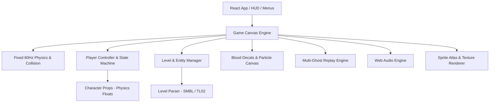

# Super Meat Boy Web Rewrite Architecture & Delegation Plan

## System Architecture

## Subagent Workstream Breakdown

| Subagent | Role | Target Model | Responsibilities |
|---|---|---|---|
| **Agent 1** | Level Parser & Entity Engine | `gemini-3.8-flash-high` | `.smbl` binary parser, tilemap generator, saw / hazard paths, start & goal extraction |
| **Agent 2** | Physics & Player State Machine | `opencode/muse-spark-1.3-contributor-free` (high) | Exact 1:1 movement equations from `.props`, wall jumps, friction, coyote time |
| **Agent 3** | Canvas Renderer & Particle System | `gemini-3.8-flash-high` | Parallax camera, tile rendering, sprite transforms, rotating saws, blood splatter buffer |
| **Agent 4** | Multi-Ghost Replay System | `opencode/muse-spark-1.3-contributor-free` (high) | Input & state recording, simultaneous playback of all failed attempts upon level completion |
| **Agent 5** | Web Audio & SFX/OST Manager | `gemini-3.8-flash-high` | Web Audio API loader, SFX playback, looping music tracks, volume controls |
| **Agent 6** | React UI, Menus & Level Progression | `gemini-3.8-flash-high` | Chapter select, level grid (1-20 + Dark World), HUD, character select, gamepad support |
