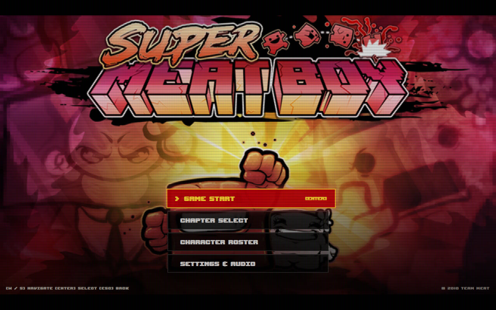
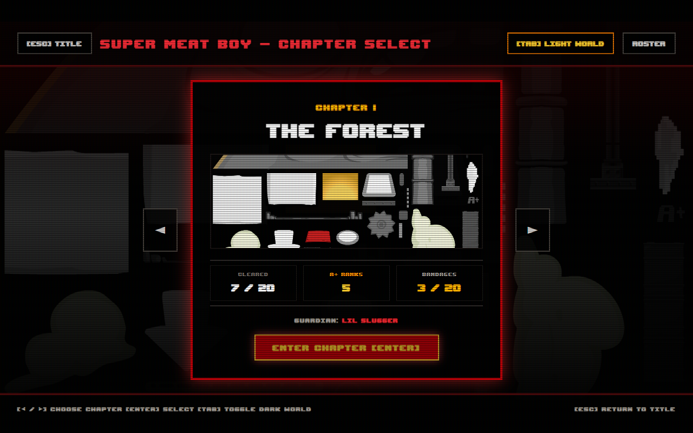
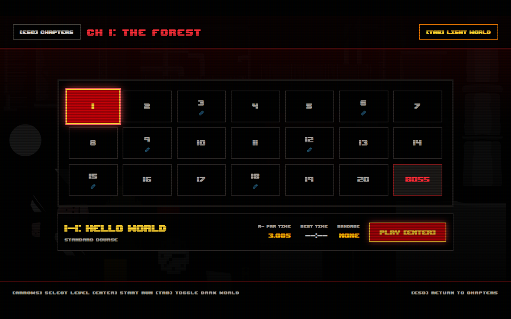
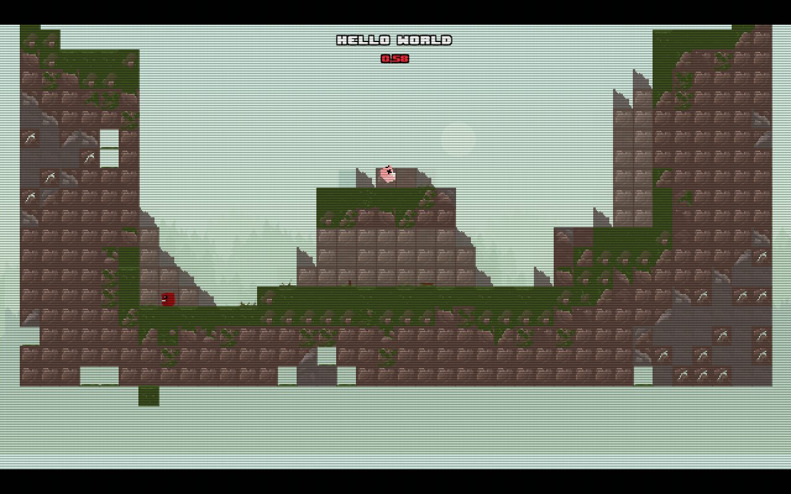
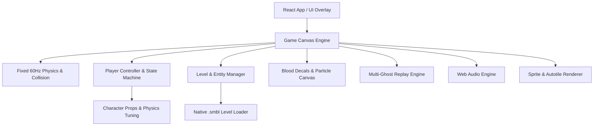

# Super Meat Boy Web Rewrite 

A high-fidelity, web-native rewrite and recreation of Team Meat's iconic precision platformer **Super Meat Boy**, built using modern web technologies: React 18, TypeScript, Vite, HTML5 Canvas, Web Audio API, and Tailwind CSS.

---

##  Key Highlights

- **Precise 60Hz Physics**: Exact jump curves, variable jump height, coyote time, jump input buffering, skidding friction, wall sliding, and wall-kick steering lockouts.
- **Binary Level Engine (`.smbl`)**: Fully reverse-engineered native level parser decoding both `TL01` and `TL02` container formats with bit-packed RLE tile layers, dynamic autotiling, and hazard placement. Includes 590+ official binary levels.
- **Persistent Blood Canvas**: Blood decals, splatter chunks, wall smear trails, and dripping droplets persist across attempts and deaths until level reload or transition.
- **Simultaneous Multi-Ghost Replays**: Every failed death run within a session is recorded and played back simultaneously alongside your successful run once Bandage Girl is rescued!
- **Roster of Unlockable Characters**: Distinct physics profiles and special abilities for Meat Boy, Commander Video (mid-air hover float), The Kid (double jump), Flywrench (multi-flap), and more.
- **Authentic UI & Retro Presentation**: Complete menu flow featuring Title Screen, Chapter Select, Level Select Grid (Light World & Dark World + A+ par times), Settings, Pause Menu, CRT scanlines, and arcade bezel styling.
- **Cross-Platform Input**: Comprehensive Keyboard, Gamepad API, and responsive on-screen mobile Touch overlay support.
- **Web Audio Sound System**: Multi-track music loops and dynamic sound effects with independent volume routing.

---

##  Screenshots

| Title Menu & Chapter Select | Level Grid & Progression |
|:---:|:---:|
|  |  |
|  |  |

---

##  Architecture & Subsystems



### 1. Physics & Collision (`src/engine/physics.ts` & `playerController.ts`)
- **Fixed Timestep**: Runs at a rock-solid 60Hz with 4 internal sub-steps per frame (`dt = ~4.16ms`) to completely eliminate tunneling through high-velocity hazards or thin walls.
- **Collision Detection**: Continuous point-to-circle and AABB-to-circle testing with lenient inner radii on hazard tips to match original gameplay feel.
- **Platform Mechanics**: One-way jump-through platforms, 45-degree terrain slopes with real-time floor elevation evaluation, and crumbling blocks.

### 2. Binary Level Loader (`src/engine/levelParser.ts`)
- Decodes little-endian binary Super Meat Boy levels (`.smbl`):
  - Palette block parsing (256-byte table).
  - Spawn coordinates and camera boundaries.
  - 8-layer parallax descriptors + 3-layer 32-bit RLE tile words (10-bit run length, 22-bit tile data).
  - 50-byte object records (buzzsaws, bandage locations, crumble blocks, Lil' Slugger boss entities).
- Inverted Y-axis conversion (converting game coordinate origins to HTML5 2D canvas space).

### 3. Blood Decals & Splatter Engine (`src/engine/bloodDecals.ts`)
- Offscreen accumulator canvas preserving gore stamps throughout repeated deaths.
- Dynamic splatters: Meat explosions on buzzsaw contact (30+ ballistic meat chunks), wall slides dripping down surfaces, and faint walking footprints vs. elongated sprint blood streaks.
- Viewport-clamped blitting for zero CPU/GPU overhead during rendering.

### 4. Ghost Replay Recorder (`src/engine/replayEngine.ts`)
- Continuous ring buffer capturing frame-by-frame state (position, velocity, facing angle, squish animation factor, and death timestamps).
- Post-win modal rendering all prior failed ghosts simultaneously in semi-transparent tints, with scrub controls (play, pause, step, speed scaling).

---

##  Getting Started

### Prerequisites
- Node.js (v18.0.0 or higher recommended)
- npm or pnpm

### Installation
```bash
# Clone the repository
git clone https://github.com/your-username/SuperMeatboyRewrite.git
cd SuperMeatboyRewrite

# Install dependencies
npm install
```

### Development Server
```bash
npm run dev
```
Open [http://localhost:5173](http://localhost:5173) in your browser.

### Production Build
```bash
npm run build
npm run preview
```

---

##  Testing

The engine includes rigorous unit and parity test suites verifying physics constants, binary parsing, and blood stamp fidelity:

```bash
# Test SMBL binary level parser
npx tsx src/engine/levelParser.test.ts

# Test player physics, wall jumps, abilities & input buffering
npx tsx src/engine/physics_player.test.ts

# Test blood decal persistence and offscreen blitting
npx tsx src/engine/bloodDecals.test.ts
```

---

##  Controls

| Action | Primary (Keyboard) | Secondary | Gamepad |
|---|---|---|---|
| **Move Left / Right** | `A` / `D` or `Left` / `Right` Arrow | Left Stick / D-Pad | Left / Right |
| **Jump / Wall Jump** | `Space` / `W` / `Up` Arrow | `Z` | `A` / Cross Button |
| **Run / Sprint / Ability** | `Left Shift` | `X` | `X` / `RT` / Square |
| **Pause Game** | `Escape` | `P` | `Start` Button |
| **Restart Level** | `R` | - | `Select` / Back Button |

---

##  Project Structure

```text
SuperMeatboyRewrite/
├── public/
│   └── assets/              # Extracted audio, textures, animations, and .smbl levels
├── src/
│   ├── components/          # React menus, HUD, GameCanvas, ReplayModal, Settings
│   │   ├── ChapterSelect.tsx
│   │   ├── CharacterSelect.tsx
│   │   ├── GameCanvas.tsx
│   │   ├── HUD.tsx
│   │   ├── LevelGrid.tsx
│   │   ├── PauseMenu.tsx
│   │   ├── ReplayModal.tsx
│   │   └── TitleScreen.tsx
│   ├── engine/              # Core game engine logic
│   │   ├── bloodDecals.ts   # Persistent gore canvas system
│   │   ├── bossLilSlugger.ts# Chapter 1 Boss battle logic
│   │   ├── input.ts         # Keyboard, gamepad, and touch input manager
│   │   ├── levelParser.ts   # Binary .smbl level reader and autotiler
│   │   ├── physics.ts       # 60Hz physics, collisions, and substepping
│   │   ├── playerController.ts # Player state machine and movement
│   │   ├── renderer.ts      # HTML5 Canvas 2D scene renderer
│   │   ├── replayEngine.ts  # Multi-ghost replay recorder and player
│   │   └── sound.ts         # Web Audio sound FX and music loops
│   ├── App.tsx              # Root React state & screen coordinator
│   └── main.tsx             # Application entry point
├── tools/                   # Extraction and reverse engineering scripts
├── package.json
└── tsconfig.json
```

